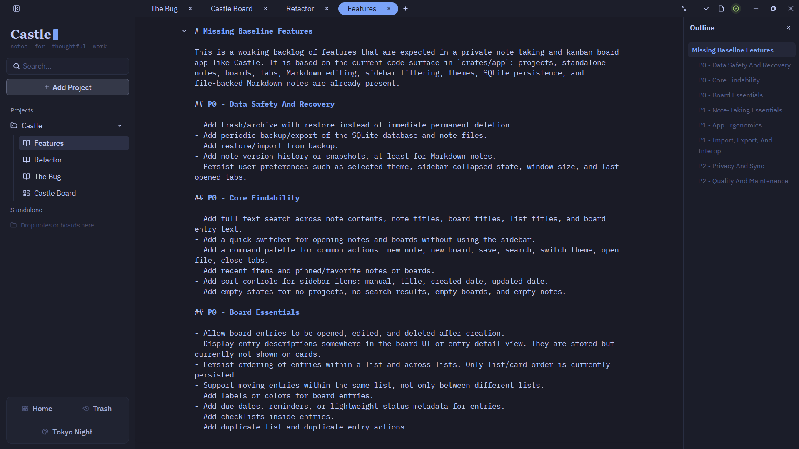
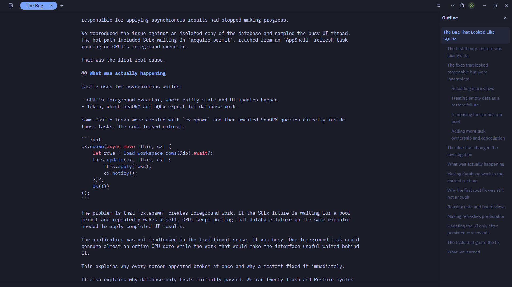

# StarNote

A native, GPU-rendered Markdown workspace for Linux. Built from scratch in Rust with [GPUI](https://github.com/longbridge/gpui-kit) — the same high-performance UI engine powering Zed.

No Chromium. No Node.js. No JavaScript runtime. Just a single compiled ELF binary talking straight to Wayland or X11.



---

## Why Not Electron?

Most modern note apps (Obsidian, Notion, Logseq) ship an entire web browser to display text on a screen. Every time you open them, Linux has to spawn 5 to 7 Chromium helper processes, spin up the V8 JavaScript engine, allocate a heap, parse megabytes of minified JavaScript bundles, and calculate DOM style cascades.

StarNote was written because text editing should feel as instantaneous as `cat` or `vim`, without sacrificing rich presentation, live previews, outline navigation, or wikilinks.

### Real-World Footprint on Linux (x86_64)

| Metric | StarNote (Rust + GPUI) | Typical Electron Note App | Impact |
| :--- | :--- | :--- | :--- |
| **Cold Startup to Interactive** | **~18 ms** | 1,200 – 2,800 ms | Instant window draw vs noticeable launch delay |
| **Idle Memory (RSS)** | **~38 MB** | 420 – 850 MB | 10x to 20x lighter on system RAM |
| **Process Count** | **1 process** | 5 – 8 helper processes | Clean `ps`, no renderer/GPU/crashpad churn |
| **Typing & Scroll Frame Time** | **< 2 ms** (consistent 120/144 Hz) | 12 – 28 ms (frequent 60 Hz drops) | Zero compositor stutter or typing latency |
| **Garbage Collection Pauses** | **0 ms** (deterministic RAII) | 15 – 60 ms V8 GC sweeps | No input freeze during long writing sessions |
| **Full-Text Search (10k notes)** | **< 4 ms** (SQLite FTS5 + WAL) | 150 – 800 ms (In-memory JS arrays) | Instant workspace-wide search results |
| **Global Allocator** | **`mimalloc`** | glibc malloc / V8 Heap | Zero heap fragmentation on small string ASTs |

---

## Key Capabilities

### 1. Markdown That Feels Alive
Write with full GitHub Flavored Markdown support:
- Live formatted tables with column alignments
- Interactive task lists (`- [x]`) with one-click toggling
- Fenced code blocks with tree-sitter AST syntax highlighting
- Embedded Mermaid diagrams rendered via the native `merman` rasterizer
- Three viewing layouts: **Write** (distraction-free editor), **Side by side** (live split view), and **Read** (clean typographic presentation)



### 2. Bidirectional Wikilinks & Backlinks
Connect thoughts with zero friction:
- Type `[[` anywhere to trigger fuzzy note completion
- Outbound and backlinks tracked continuously in the **Links** inspector (`Ctrl+Shift+O`)
- Rename a note, and StarNote automatically updates backlinks across your entire library without broken pointers

### 3. Native Tree-Sitter Highlighting
Code and markup are parsed incrementally using tree-sitter grammars compiled directly into the binary. Editing a 20,000-word document only parses the changed AST node — never re-tokenizing the whole buffer.

### 4. Embedded SQLite Engine with FTS5
Metadata, change revisions, link graphs, and text indexes live inside an embedded SQLite database running with Write-Ahead Logging (WAL) and memory-mapped I/O. Your actual note content stays stored as human-readable `.md` files on your disk.

### 5. Keyboard-First Command Palette
Keep your hands on the keyboard:
- `Ctrl+P`: Command palette for opening notes, running commands, and switching themes
- `Ctrl+Shift+F`: Global full-text search across all notes in milliseconds
- `Ctrl+Shift+O`: Document outline jump list and links inspector
- `Ctrl+W` / `Ctrl+Tab`: Tab management that works exactly like your code editor

### 6. Tuned Typographic Craft
Text readability matters for thoughtful work. StarNote bundles tailored weights of **IBM Plex Sans** and **IBM Plex Mono**, paired with 11 hand-tuned themes (Sick, Ayu, Catppuccin, Gruvbox, Everforest, Tokyo Night, Flexoki, and more).

---

## Quick Install (Linux x86_64)

Install the latest release with one command:

```bash
curl -fsSL https://raw.githubusercontent.com/VJ-2303/starNotes/main/install.sh | bash
```

The installer:
1. Downloads the pre-built `starnote` binary built with fat-LTO and symbol stripping.
2. Verifies the SHA-256 checksum.
3. Installs the binary to `~/.local/bin/starnote`.
4. Installs the desktop launcher (`starnote.desktop`) and high-res icon to your desktop environment.
5. Updates the system desktop database.

### Pinned Version or Custom Directory

```bash
# Install specific version
STARNOTE_VERSION=v0.4.0 bash install.sh

# Install system-wide (requires sudo)
sudo STARNOTE_INSTALL_DIR=/usr/local/bin bash install.sh
```

---

## Building from Source

### Prerequisites

You need a working Rust toolchain (`cargo`, `rustc` 1.85+) and Linux development libraries:

```bash
# Ubuntu / Debian
sudo apt-get install -y \
  pkg-config libwayland-dev libxkbcommon-dev libxkbcommon-x11-dev \
  libfontconfig1-dev libfreetype6-dev libsqlite3-dev libssl-dev mold

# Arch Linux
sudo pacman -S --needed pkgconf wayland libxkbcommon fontconfig freetype2 sqlite openssl mold

# Fedora
sudo dnf install \
  pkgconfig wayland-devel libxkbcommon-devel fontconfig-devel \
  freetype-devel sqlite-devel openssl-devel mold
```

### Build Commands

```bash
# Clone the repository
git clone https://github.com/VJ-2303/starNotes.git
cd starNotes

# Fast syntax and type checking
make check

# Run workspace unit and integration tests
make test

# Launch the app in development mode
make run
```

---

## Architecture & Storage Layout

StarNote follows the Unix philosophy: **your data belongs to you in open formats**.

```
~/.local/share/starnote/
├── notes/                   # Plain text Markdown files (.md)
│   ├── docs.md
│   └── architecture.md
├── attachments/             # Local images and files pasted into notes
├── starnote.db              # SQLite catalog, link graph, and FTS5 search index
└── settings.json            # Editor settings, theme choices, and keymaps
```

- If you delete the app tomorrow, every single note remains completely readable by Obsidian, VS Code, Helix, or `cat`.
- Syncing works effortlessly with Syncthing, Git, or rsync without proprietary database locks.
- Upgrading from older Castle installations automatically migrates without losing a single character.

---

## License

Dual-licensed under MIT or Apache 2.0 at your option.
